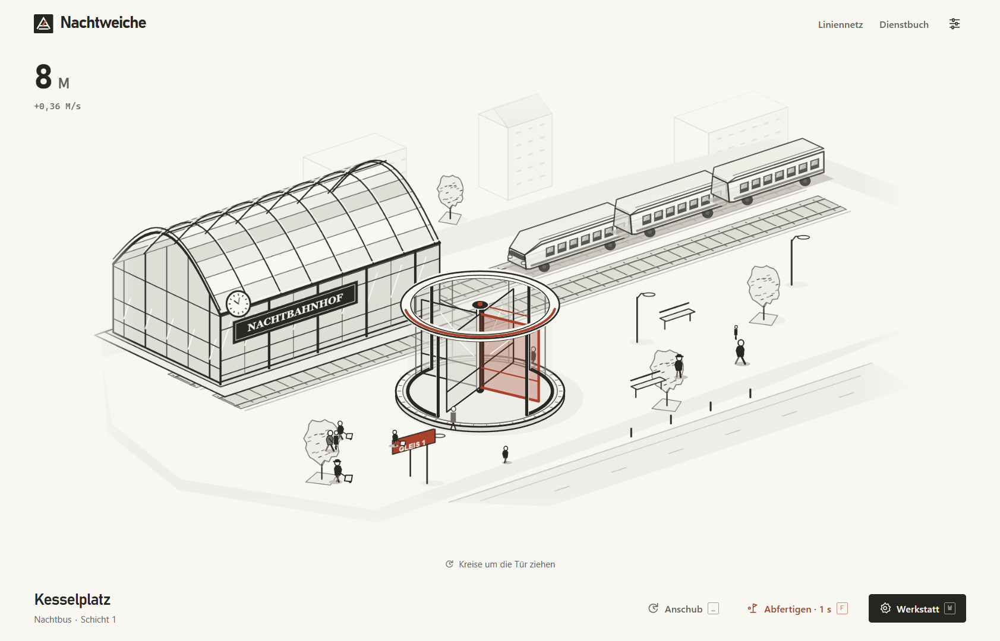

# Nachtweiche

Ein Idle- und Incremental-Spiel für Windows. Am Kesselplatz beginnt die Nachtschicht mit einer Drehtür, einem Nachtbus und acht Mark. Zieh Kreise um die Tür, fertige ankommende Verbindungen ab und baue den Bahnhof bis zur Horizontlinie aus.

**[Nachtweiche für Windows herunterladen](https://github.com/richardkulinna/nachtweiche/releases/latest/download/Nachtweiche.exe)**

Die einzelne EXE läuft auf Windows x64 ohne Installer. Grafik, Klänge und Musik entstehen lokal. Das Spiel ist auf Deutsch.



## Spielen

- **Drehen.** Ziehe mit gedrückter Maustaste Kreise um das Drehkreuz. Die Leertaste oder **Anschub** geben ebenfalls Schwung. Mehrere Anschübe in Folge bilden eine Serie.
- **Abfertigen.** Sobald ein Fahrzeug einfährt, bringt **F** ein besonders gutes Signal. Außerhalb des Zeitfensters passieren einzelne Reisende die Tür.
- **Ausbauen.** **W** öffnet die Werkstatt. Die acht Mark Startgeld reichen für die erste Motorstufe. Werbung, Türweite und Fahrpreis wirken unterschiedlich auf den Ertrag. Sechs Flügelformen unterstützen verschiedene Spielweisen.
- **Eine Linie übernehmen.** Im Liniennetz wählst du unter den erschlossenen Verbindungen. Jede hat ihren eigenen Takt. Auf Wunsch nimmst du eine Kurskarte an und begleitest einen Fahrgast über mehrere Linien. Die letzte Lochung bringt eine Geschichte, einen Stempel und eine Fahrgeldprämie.
- **Eine neue Schicht eröffnen.** Unter *Liniennetz → Konzession* siehst du Umsatzgrenze, Startkapital und Netzmarken. Spätere Konzessionen eröffnen unter anderem automatische Abfertigung und ein längeres Einfahrtsfenster.

Die Kampagne umfasst acht Kapitel, 22 Linien, sieben Ausbaukategorien, sieben dauerhafte Konzessionsvorteile, 16 Dienstaufträge und 16 Kurskarten. Die Abschlussfahrkarte hält die Bilanz fest. Danach kannst du weiterfahren.

## Spielstand und Darstellung

Nachtweiche speichert regelmäßig, bei wichtigen Aktionen und beim Schließen. Bei der Rückkehr werden bis zu 24 Stunden Offline-Betrieb abgerechnet. Zwei lokale Spielstanddateien wechseln sich ab. Beim Laden prüft das Spiel ihre Prüfsummen und verwendet den jüngsten intakten Stand. Die Dateien liegen unter `%APPDATA%\Nachtweiche`.

Die Einstellungen enthalten Nachtmodus, Schwarzweiß, erhöhten Kontrast, reduzierte Bewegung, Szenendichte sowie getrennte Regler für Gesamt- und Musiklautstärke. **F1** öffnet das Handbuch, **F11** wechselt ins Vollbild.

## Bauen und prüfen

Auf Windows mit Node.js 22 oder neuer im Projektverzeichnis ausführen.

```powershell
npm ci
npm start
```

Die portable Windows-Version bauen und prüfen.

```powershell
npm run dist
node test-engine.cjs
node tests/save.cjs
node tests/play.cjs Release/Nachtweiche.exe
```

Der Fenstertest startet die EXE mit einem eigenen temporären Profil. Er prüft unter anderem Mausgesten, Einkäufe, Kurskarten, Prestige, die Darstellung bei kleiner Fenstergröße, die Abschlussfahrkarte und Offline-Ertrag nach einem echten Neustart. Screenshots landen in `test-results`. [Prüfbericht zur veröffentlichten EXE](docs/pruefung.md)

### Simulierte Kampagnendauer

Die Simulation verwendet dieselben Spielregeln wie die EXE. Die Testspieler kaufen alle 30 Sekunden ein, wählen erschlossene Linien und lösen passende Aufträge ein. Optionale Kurskartenprämien sind in diesen Läufen unberücksichtigt.

| Spielweise im Test | Zeit bis zur Abschlussfahrkarte |
| --- | ---: |
| Zwei Anschübe pro Sekunde und pünktliche Signale | 10 Std. 31 Min. |
| Ein Anschub pro Sekunde und pünktliche Signale | 14 Std. 03 Min. |
| In zwei von zehn Minuten aktiv | 19 Std. 16 Min. |
| Automatik mit regelmäßigen Kauf- und Linienentscheidungen | 24 Std. 39 Min. |

Die tatsächliche Spielzeit hängt von Linienwahl, Flügelform, Ausbauten und Pausen ab.

## Gestaltung

Die von Hand angetriebene Drehtür, ihr Schwungrad und die isometrische Schwarzweißgrafik waren der Ausgangspunkt. Nachtweiche verlegt diese Idee in einen Nachtbahnhof. Eigene Fahrpläne, Kurskarten, Figuren, Zeichnungen und Musik tragen die Kampagne. [Round and Round Inc. auf Steam](https://store.steampowered.com/app/5455960/Round_and_Round_Inc/)

Die Ausbaupreise, das Wechselspiel zwischen Kapazität und Nachfrage sowie der schnellere Wiedereinstieg nach einem Schichtwechsel orientieren sich an Anthony Pecorellas Analysen zu Produktionskurven und Prestige. [The Math of Idle Games, Teil I](https://www.kongregate.com/en/pages/the-math-of-idle-games-part-i) · [Teil III](https://www.kongregate.com/en/pages/the-math-of-idle-games-part-iii)
